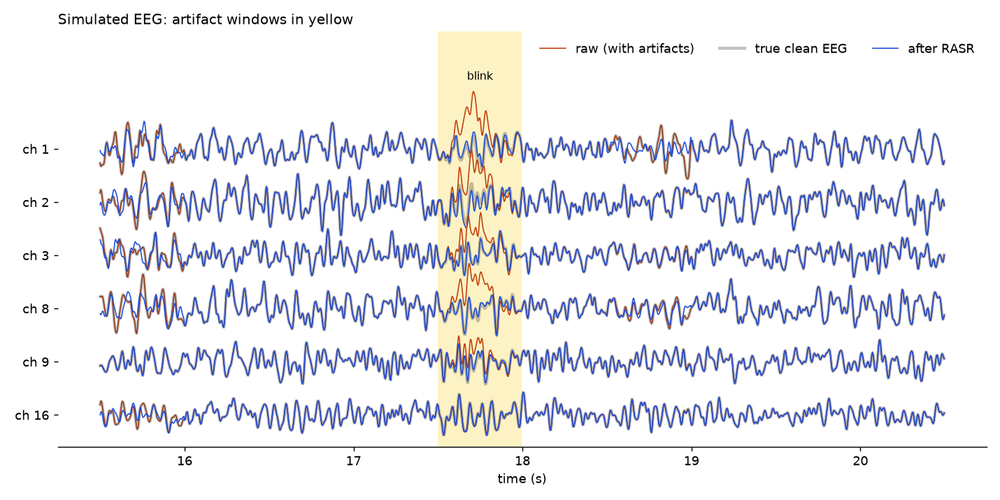
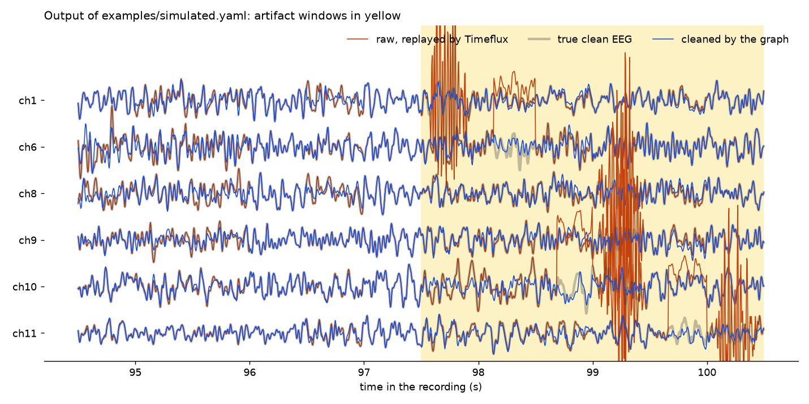

Timeflux rASR
=============

**Real-time EEG artifact removal for Timeflux.** RASR learns what clean EEG
looks like from a short calibration recording, then cleans every new window
of signal on the fly. Eye blinks, muscle bursts and electrode pops are
removed, and the brain activity underneath is kept.

It implements Artifact Subspace Reconstruction (ASR, Kothe & Jung, the
``clean_rawdata`` EEGLAB plugin) and options from its Riemannian variant
(rASR, Blum et al. 2019), as a scikit-learn estimator that runs in a
`Timeflux <https://timeflux.io>`__ graph or in plain Python.

*Simulated EEG* (``examples/quickstart.py``)*: a blink (yellow window) on top
of clean EEG. RASR (blue) removes it and follows the true clean EEG (grey).
Outside the artifacts, the orange raw signal equals the truth; where it shows,
RASR slightly altered a clean window.*

Contents
--------

* `Why RASR`_
* `How it works`_
* `Installation`_
* `Quick start in Python`_
* `Use it in Timeflux, step by step`_
* `Parameters`_
* `Validation on simulated data`_
* `Differences with the MATLAB code and known limitations`_
* `Repository layout`_
* `References`_

Why RASR
--------

EEG is easily drowned out by artifacts that are 10 to 100 times larger than
brain activity: blinks and eye movements, jaw and neck muscles, cable
movements, electrodes losing contact. Offline, you can reject the bad
segments by hand or with ICA. In real time (neurofeedback, brain-computer
interfaces, live monitoring), you need something that:

* decides on its own, window by window, in a few milliseconds;
* repairs the signal instead of dropping it, so the stream never stops;
* only needs a minute of clean data to calibrate.

That is what ASR does. It treats large-variance directions of the
multichannel signal as artifacts when their variance exceeds what was seen
during calibration, and it rebuilds those directions from the other
channels.

How it works
------------

RASR works on windows of signal, for example 0.5 s, with shape
``(n_samples, n_channels)``. The data must already be band-pass filtered
(e.g. 1-40 Hz).

**Calibration** (``fit``), on clean data, at least 100 windows:

1. Compute the covariance matrix :math:`C_k` of each window.
2. Take their geometric median :math:`\bar{C}`, which is robust to a few
   bad windows. It is Euclidean by default, as in ASR and in the rASR MATLAB
   code; ``metric='riemann'`` uses the Riemannian median instead. The mixing
   matrix is :math:`M = \bar{C}^{1/2}`.
3. Diagonalize :math:`M = V \Lambda V^\top` (principal components).
4. For each component :math:`v_c`, fit the distribution of the RMS
   amplitude of :math:`v_c^\top x` over the calibration windows, and set
   the threshold :math:`\tau_c = \mu_c + k\,\sigma_c`, where :math:`k` is
   ``rejection_cutoff``. The threshold operator is
   :math:`T = \mathrm{diag}(\tau) V^\top`.

**Cleaning** (``transform``), for each new window :math:`X`:

1. Diagonalize its covariance :math:`C = U D U^\top`, eigenvalues ascending.
2. Component :math:`c` is an artifact if its variance :math:`d_c` exceeds
   its threshold projected on it, :math:`\|T u_c\|^2`. At most
   ``max_dimension`` of the components can be removed.
3. Rebuild the window from the kept components with the calibration mixing
   matrix: :math:`R = M\,(K U^\top M)^{+}\,U^\top`, where :math:`K` keeps
   the good components, then :math:`X_{clean} = X R^\top`. If nothing is
   above threshold, :math:`R` is the identity and the window passes
   unchanged.

Because each window gets its own :math:`R`, consecutive windows can join
with a small jump. Use overlapping windows and the ``Blending`` estimator to
cross-fade them (raised-cosine interpolation, as in the MATLAB code).

Installation
------------

You need Python 3.10 or newer. In a fresh environment:

.. code-block:: bash

    pip install timeflux timeflux-rasr

or, to work on the code and run the examples:

.. code-block:: bash

    git clone https://github.com/timeflux/timeflux_rasr
    cd timeflux_rasr
    pip install -e ".[dev]"

Check that it works:

.. code-block:: bash

    python -c "from timeflux_rasr.estimators.rasr import RASR; print('ok')"

.. note::

   Timeflux 0.17 requires NumPy 1.26, and pyRiemann 0.12 requires NumPy 2.
   Until Timeflux supports NumPy 2, ``timeflux-rasr`` installs pyRiemann
   0.11 or older. If you see ``AttributeError: 'numpy.ndarray' object has
   no attribute 'mT'``, run ``pip install "pyriemann<0.12"``.

Quick start in Python
---------------------

No Timeflux needed. RASR is a scikit-learn transformer on arrays of shape
``(n_windows, n_samples, n_channels)``:

.. code-block:: python

    from timeflux_rasr.estimators.rasr import RASR
    from timeflux_rasr.helpers.simulation import (
        add_artifacts, clean_eeg, mixing_matrix, to_epochs, from_epochs)

    # 2 min of clean calibration EEG, 1 min of test EEG with artifacts (16 channels, 250 Hz)
    mixing = mixing_matrix(n_channels=16, random_state=0)
    calibration = clean_eeg(120 * 250, 250, mixing, random_state=1)
    truth = clean_eeg(60 * 250, 250, mixing, random_state=2)
    raw, bad, kinds = add_artifacts(truth, 250, window=125, rate=0.2, random_state=3)

    rasr = RASR(rejection_cutoff=5).fit(to_epochs(calibration, 125))  # 0.5 s windows
    cleaned = from_epochs(rasr.transform(to_epochs(raw, 125)))

``python examples/quickstart.py`` runs this, prints the errors against the
known clean EEG, and draws the figure at the top of this page:

.. code-block:: text

    22 artifacts (blink, muscle, pop)
    windows with artifacts: error 1.71 raw -> 0.47
    clean windows:          error 0.00 raw -> 0.22

The error is :math:`\|\hat{X} - X_{clean}\| / \|X_{clean}\|`. On artifact
windows, RASR divides it by about 3.6. On clean windows, it adds some
distortion; raise ``rejection_cutoff`` to reduce it (see `Validation on
simulated data`_).

Use it in Timeflux, step by step
--------------------------------

**What Timeflux is, in two sentences.** Timeflux runs *graphs* of *nodes*
described in a YAML file: each node is a small Python class that receives
pandas DataFrames on its inputs and sends DataFrames on its outputs, and
the graph runs again and again at a fixed rate. You run a graph with
``timeflux -d my_graph.yaml`` (``-d`` shows debug messages).

We will clean a simulated recording, so that everything below works
without an amplifier.

**Step 1: make a recording.**

.. code-block:: bash

    python examples/simulate_recording.py

This writes ``examples/data/simulated.hdf5``, the same format Timeflux uses
to save real recordings: 2 minutes of 16-channel EEG at 250 Hz under
``/eeg/raw`` (the first minute is clean, the second has artifacts), and two
events under ``/events``, ``calibration_begins`` at the start and
``calibration_ends`` after one minute. Events are how you tell RASR when to
learn: in a real experiment you would send them from your stimulation
software, or ask the participant to sit still and blink as little as
possible during that minute.

**Step 2: read the graph.** ``examples/simulated.yaml`` has four nodes,
joined by edges (``source`` → ``target``):

.. code-block:: text

    replay ──eeg_raw──▶ window ──0.5 s windows──▶ rasr ──cleaned windows──▶ save
       └────events────────────────────────────────▶ rasr
       └────eeg_raw───────────────────────────────────────────────────────▶ save

* ``replay`` (``timeflux.nodes.hdf5.Replay``) reads the file and sends it as
  if it came from an amplifier, in small chunks, here 4 times faster than
  real time (``speed: 4``).
* ``window`` (``timeflux.nodes.window.Slide``) cuts the stream into
  0.5 s windows (``length: 0.5``, ``step: 0.5``, ``rate: 250``). Use
  ``Slide``, not the deprecated ``Window`` node, which sends at most one
  window per cycle and loses windows when data arrives in larger chunks.
* ``rasr`` (``timeflux.nodes.ml.Pipeline``) wraps scikit-learn estimators.
  It stores the windows it receives between ``calibration_begins`` and
  ``calibration_ends`` (``event_start_accumulation``,
  ``event_stop_accumulation``), fits RASR on them in the background when
  ``calibration_ends`` arrives (``event_start_training``), then transforms
  every new window (``mode: transform``). ``meta_label: null`` says that no
  labels are needed. The windows go to two inputs: ``rasr:training`` for
  calibration and ``rasr`` for cleaning.
* ``save`` (``timeflux.nodes.hdf5.Save``) writes the raw and the cleaned
  signals to ``examples/results/simulated_cleaned.hdf5``.

Parameters of the estimator go under ``args``:

.. code-block:: yaml

    steps:
      - module: timeflux_rasr.estimators.rasr
        class: RASR
        args:
          rejection_cutoff: 5

**Step 3: run it.**

.. code-block:: bash

    cd examples
    timeflux -d simulated.yaml

It takes about 30 seconds. In the log you will see ``Start accumulation``,
``Stop accumulation``, ``Start training`` and ``Model fitted in 2.5
seconds``; the graph stops by itself at the end of the file.

**Step 4: look at the result.**

.. code-block:: bash

    cd ..
    python examples/plot_timeflux_result.py

.. code-block:: text

    cleaned 82% of the test minute (49.5 s)
    windows with artifacts: error 1.72 raw -> 0.56
    clean windows:          error 0.00 raw -> 0.42

The muscle bursts and most of the electrode pops are removed. Some steps
are only partly corrected (ch1 around 98.2 s, ch10 around 99.7 s). The
numbers match RASR run offline on the same 120 calibration windows (0.54
and 0.43), so the graph does exactly what the estimator does. Note that 18 %
of the test minute was not cleaned: the windows that arrived while the model
was being fitted (2.5 s, i.e. 10 s of data at speed 4) are not output by the
``Pipeline`` node. In real time (``speed: 1``) only the windows of the fitting time itself are lost.

**Step 5: use your own amplifier.** Replace ``replay`` by the input node of
your device, for example ``timeflux.nodes.lsl.Receive`` for any amplifier
that streams with LabStreamingLayer, and add a band-pass filter before the
window, for example ``timeflux_dsp.nodes.filters.IIRFilter`` from
`timeflux_dsp <https://github.com/timeflux/timeflux_dsp>`__. To see the
signal before and after cleaning in your browser, send both to
`timeflux_ui <https://github.com/timeflux/timeflux_ui>`__.
``examples/replay.yaml`` shows such a graph (filter, overlapping windows,
``Blending``, live display) on a real recording, ``data/sme_1_1.gz.hdf5``.

Parameters
----------

``RASR(estimator='scm', rejection_cutoff=3.0, max_dimension=0.66, metric='euclid', **kwargs)``

``rejection_cutoff``
    Threshold in standard deviations of the calibration RMS distribution.
    2.5 is aggressive, 5 conservative. This is the main knob: lower removes
    more artifact but distorts more clean EEG.
``max_dimension``
    Largest fraction of components that can be removed in one window.
``estimator``
    Covariance estimator from pyRiemann (``'scm'``, or ``'lwf'`` / ``'oas'``
    for regularized estimates with few samples per window).
``metric``
    ``'euclid'`` (default) or ``'riemann'``: geometric median of the
    calibration covariances.
``min_clean_fraction``, ``max_dropout_fraction``, ``quantile_range``, ``step_sizes``, ``beta_range``
    Passed to the robust fit of the RMS distribution; keep the defaults.

After ``fit``: ``mixing_`` (:math:`M`), ``threshold_`` (:math:`T`) and
``Ne_`` (number of channels).

``Blending(window_overlap=1, merge=False, windowing=None)`` cross-fades the
``window_overlap`` samples shared by consecutive windows.

Validation on simulated data
----------------------------

``notebooks/synthetic_validation.py`` measures the error against the known
clean EEG on 5 simulations (16 channels, 0.5 s windows, artifacts on 20 %
of the windows, raw artifact error about 1.6), with clean or 20 %
contaminated calibration data. It also compares with
`meegkit <https://github.com/nbara/python-meegkit>`__'s ASR, an independent
Python port of the MATLAB code, streamed window by window. With artifacts
straddling two windows (the realistic case), median errors on artifact /
clean windows:

=======================  =============  =============  =============
method                   cutoff 3       cutoff 5       cutoff 10
=======================  =============  =============  =============
RASR, Euclidean          0.63 / 0.47    0.54 / 0.18    0.58 / 0.06
RASR, Riemannian median  0.68 / 0.56    0.55 / 0.32    0.56 / 0.07
meegkit 0.2 ASR          0.65 / 0.47    0.55 / 0.26    0.61 / 0.09
meegkit 0.2 rASR         1.63 / 0.24    1.56 / 0.11    1.61 / 0.08
=======================  =============  =============  =============

(clean calibration; pyRiemann 0.12, NumPy 2.5.) RASR matches meegkit's ASR
on artifact removal and distorts clean windows less at cutoffs 5 and 10.
The Riemannian median brings no gain here, and meegkit's Riemannian mode
barely removes any artifact on these data.

Differences with the MATLAB code and known limitations
------------------------------------------------------

* **Stateless.** ``transform`` cleans each window on its own, so the
  estimator can be cross-validated like any scikit-learn transformer. The
  MATLAB ``asr_process`` keeps a state between calls: blending of
  consecutive reconstruction matrices (here, the separate ``Blending``
  estimator) and, in rASR, the Karcher mean of the current and previous
  window covariances (not implemented).
* **Riemannian PCA.** rASR's ``rasr_nonlinear_eigenspace`` is called with
  as many components as channels; in that case the Grassmann optimization
  cannot move and the result is the eigendecomposition of
  :math:`L + \mathrm{diag}(L^{-1}\mathbf{1})`. See issue #14 and PR #38.
* **Calibration needs at least 100 windows** (50 s of 0.5 s windows).
* **Windows received while the model is fitted are not output** by the
  Timeflux ``Pipeline`` node.
* Blink-like artifacts spread over many channels and pops are harder than
  focal muscle bursts: steps are sometimes only partly corrected.

Repository layout
-----------------

.. code-block:: text

    timeflux_rasr/
        estimators/rasr.py        RASR estimator and the robust RMS distribution fit
        estimators/blending.py    Blending estimator (cross-fade of overlapping windows)
        helpers/simulation.py     simulated EEG with known artifacts
        helpers/                  plotting and data-loading utilities
    examples/
        quickstart.py             Python example on simulated data
        simulate_recording.py     writes a simulated recording for Timeflux
        simulated.yaml            Timeflux graph that cleans it
        plot_timeflux_result.py   compares the graph output with the truth
        replay.yaml               graph on a real recording, with filter and live display
    notebooks/                    validation and comparisons with MATLAB and meegkit
    test/                         pytest suite
    doc/                          Sphinx documentation (built by docinit)

References
----------

* S. Blum, N. S. J. Jacobsen, M. G. Bleichner, S. Debener, "A Riemannian
  modification of artifact subspace reconstruction for EEG artifact
  handling", *Frontiers in Human Neuroscience* 13:141, 2019.
  `Paper <https://www.frontiersin.org/articles/10.3389/fnhum.2019.00141/full>`__,
  `rASR MATLAB code <https://github.com/s4rify/rASRMatlab>`__.
* ASR in EEGLAB: `clean_rawdata <https://github.com/sccn/clean_rawdata>`__,
  `documentation <https://sccn.ucsd.edu/wiki/Artifact_Subspace_Reconstruction_(ASR)>`__.
* C.-Y. Chang, S.-H. Hsu, L. Pion-Tonachini, T.-P. Jung, "Evaluation of
  artifact subspace reconstruction for automatic artifact components
  removal in multi-channel EEG recordings", *IEEE Transactions on Biomedical
  Engineering* 67(4):1114-1121, 2020.

MIT License. Developed by the Timeflux team.
